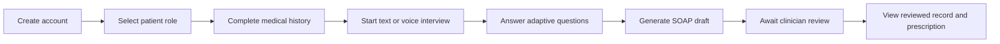
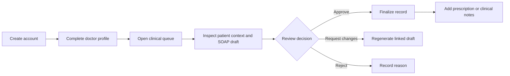
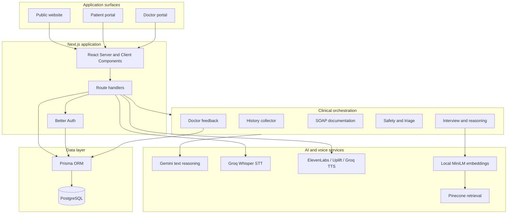

<div align="center">


# Medico

### Bilingual clinical intake, structured documentation, and clinician review

[](https://nextjs.org/)
[](https://react.dev/)
[](https://www.typescriptlang.org/)
[](https://www.postgresql.org/)
[](#project-status)

[Overview](#overview) · [Product screens](#product-screens) · [Architecture](#system-architecture) · [Setup](#getting-started) · [Documentation](#documentation)

</div>

---

## Overview

Medico is a doctor-supervised clinical intake and documentation platform designed for multilingual healthcare workflows. Patients can provide their medical history and complete an adaptive interview in English, Urdu, or Roman Urdu using text or voice. The application organizes the collected information into a structured SOAP draft, assigns a triage priority, and routes the record to a clinician for review.

The system is intentionally human-in-the-loop. AI output remains a draft until a doctor reviews it. Medico does not replace emergency services, a physical examination, diagnostic testing, or the judgment of a licensed clinician.

### What Medico provides

| Area | Capability |
| --- | --- |
| Patient intake | Structured medical history, allergies, medications, chronic conditions, lifestyle information, and prior procedures |
| Clinical interview | Adaptive follow-up questions informed by the current conversation and stored patient context |
| Language support | English, Urdu, and Roman Urdu input with normalization for downstream reasoning |
| Voice workflow | Groq Whisper speech-to-text and an optional multi-provider text-to-speech fallback chain |
| Documentation | AI-assisted Subjective, Objective, Assessment, and Plan draft generation |
| Safety | Deterministic guardrails, red-flag checks, urgency scoring, and clinician-facing priority labels |
| Doctor review | Review queues, report inspection, approval, revision requests, notes, and prescriptions |
| Patient portal | Appointments, clinical records, prescriptions, billing, messages, profile data, and medication logs |
| Retrieval | Optional Pinecone-backed medical-context retrieval using local MiniLM embeddings |
| Authentication | Better Auth email/password sessions with optional Google OAuth |

## Project status

Medico is a competition prototype and clinical decision-support demonstration. The repository contains working patient and doctor portals, authentication, data persistence, interview orchestration, report generation, safety checks, voice routes, and clinician review flows.

Some documents describe planned security hardening, governed learning from doctor corrections, controlled model training, and formal evaluation. Those documents are design targets—not claims that the prototype is clinically validated or production-ready.

## Product screens

### Doctor dashboard

The doctor workspace presents appointments, active patients, pending reports, review activity, clinical shortcuts, and queue priorities in one view.


### Patient dashboard

The patient workspace consolidates interview access, appointments, medical records, prescriptions, health-profile status, and care-team activity.


## Clinical workflow

### Patient journey



### Doctor journey



## System architecture



The repository also includes detailed visual references:

- [System architecture diagram](docs/images/Sytem%20Architecture%20Design.jpg)
- [Agent orchestration flow](docs/images/orchestration%20flow.jpeg)
- [Medical retrieval workflow](docs/images/medical%20rag%20workflow.jpeg)

## Multi-agent clinical pipeline

Medico uses LangGraph state graphs to separate responsibilities across five clinical workflow agents.

| Agent | Responsibility | Primary output |
| --- | --- | --- |
| History Collector | Collects and validates demographics, medical history, medications, allergies, surgeries, and lifestyle information | Persistable medical-history state |
| Interview and Reasoning | Normalizes language, retrieves optional context, tracks symptoms, and selects the next clinically useful question | Interview response and evolving clinical state |
| Documentation | Converts the completed interview and medical history into structured SOAP fields | SOAP report draft |
| Safety | Applies red-flag checks, triage labels, urgency scores, and escalation guidance | Safety result and doctor-queue priority |
| Feedback | Processes clinician approval, rejection, requested changes, notes, and prescriptions | Reviewed or regenerated report state |

The orchestration layer exposes separate functions for history collection, interview turns, documentation, safety review, and doctor feedback so each stage can be tested and evolved independently.

## Technology stack

| Layer | Technologies |
| --- | --- |
| Web application | Next.js 16.1.1, React 19.2.3, TypeScript 5 |
| UI and interaction | Tailwind CSS 4, Framer Motion, GSAP, Lucide React, Radix Slot |
| API | Next.js route handlers |
| Authentication | Better Auth, Prisma adapter, optional Google OAuth |
| Database | PostgreSQL, Prisma 7 |
| Agent orchestration | LangGraph and LangChain |
| Text intelligence | Google Gemini through `@langchain/google-genai` |
| Speech-to-text | Groq Whisper Large V3 |
| Text-to-speech | ElevenLabs, Uplift AI, and Groq Orpheus fallback chain |
| Retrieval | Pinecone with local `Xenova/all-MiniLM-L6-v2` embeddings |
| Validation and output | Zod, jsPDF |

## Data model

The Prisma schema includes the following core records:

| Model | Purpose |
| --- | --- |
| `User` | Patient or doctor identity and role |
| `Session`, `Account`, `Verification` | Better Auth session and account data |
| `MedicalHistory` | Patient baseline, conditions, medications, allergies, and onboarding transcript |
| `ClinicalSession` | Interview conversation, symptoms, red flags, confidence, and status |
| `SOAPReport` | Structured report, department, priority, doctor review, and prescription |
| `DoctorProfile` | Professional profile and onboarding state |
| `PatientAppointment` | Scheduled care and doctor assignment |
| `PatientInvoice` | Service cost, coverage, patient balance, and payment status |
| `PatientMessage` | Patient and care-team communication |
| `MedicationLog` | Patient medication-adherence events |

## Repository structure

```text
medico/
├── app/
│   ├── (auth)/                 # Login and signup
│   ├── api/                    # Server route handlers
│   ├── doctor/                 # Doctor portal and review workspace
│   ├── patient/                # Patient portal and interview experience
│   └── docs/                   # In-application user documentation
├── components/
│   ├── landing/                # Public landing-page components
│   ├── medico/                 # Current Medico shells and portal experiences
│   ├── stitch/                 # Imported design implementations
│   ├── ui/                     # Shared interface components
│   └── voice/                  # Voice and medical-history experiences
├── docs/                       # Technical, product, setup, and competition documentation
├── hooks/                      # Client-side React hooks
├── lib/
│   ├── agents/                 # LangGraph agents, orchestration, guardrails, and LLM utilities
│   ├── auth.ts                 # Better Auth server configuration
│   ├── auth-client.ts          # Better Auth browser client
│   ├── pinecone.ts             # Retrieval integration
│   └── prisma.ts               # Database client
├── prisma/
│   ├── migrations/             # Versioned database migrations
│   └── schema.prisma           # Application data model
├── public/                     # Brand assets, images, fonts, and media
└── scripts/                    # Service-verification utilities
```

## Getting started

### Prerequisites

- Node.js `20.9.0` or newer
- npm
- A PostgreSQL database
- A Gemini API key for AI-assisted interview and documentation flows
- A Groq API key if speech-to-text is required
- Optional Pinecone and text-to-speech provider credentials

### 1. Clone the repository

```bash
git clone https://github.com/BlackAlpha-debug/Medico.git
cd Medico
```

### 2. Install dependencies

```bash
npm install
```

### 3. Create local configuration

macOS or Linux:

```bash
cp .env.example .env
```

Windows PowerShell:

```powershell
Copy-Item .env.example .env
```

Fill the required values in `.env`. Never commit this file or paste its credentials into issues, screenshots, or documentation.

### 4. Prepare the database

Generate the Prisma client and apply the included migrations:

```bash
npx prisma generate
npx prisma migrate deploy
```

For local schema exploration, you can also use:

```bash
npx prisma studio
```

### 5. Start the development server

```bash
npm run dev
```

Open [http://localhost:3000](http://localhost:3000).

### 6. Verify optional integrations

```bash
node scripts/verify-services.mjs
```

This checks configured service access without adding secrets to the repository.

## Environment configuration

Use `.env.example` as the authoritative template.

| Variable | Requirement | Purpose |
| --- | --- | --- |
| `DATABASE_URL` | Required | PostgreSQL runtime connection string |
| `DIRECT_URL` | Recommended | Direct PostgreSQL connection for migrations; especially useful when `DATABASE_URL` uses a pooler |
| `BETTER_AUTH_SECRET` | Required | Server-side authentication signing secret |
| `BETTER_AUTH_URL` | Required | Canonical application URL used by Better Auth |
| `NEXT_PUBLIC_APP_URL` | Required | Browser-visible application origin |
| `GOOGLE_CLIENT_ID` | Optional | Enables Google sign-in when paired with the client secret |
| `GOOGLE_CLIENT_SECRET` | Optional | Server-side Google OAuth secret |
| `GEMINI_API_KEY` | Required for AI flows | Gemini authentication for reasoning and report generation |
| `GEMINI_TEXT_MODEL` | Optional | Gemini text model override; defaults to `gemini-2.5-flash` |
| `AI_MAX_OUTPUT_TOKENS` | Optional | Output-token cap constrained by the application to 128–4096 |
| `GROQ_API_KEY` | Required for STT | Groq Whisper speech-to-text; also enables the Groq TTS fallback |
| `TTS_ENABLED` | Optional | Enables server-side text-to-speech when set to `true` |
| `ELEVENLABS_API_KEY` | Optional | First text-to-speech provider in the fallback chain |
| `UPLIFT_API_KEY` | Optional | Urdu-oriented text-to-speech fallback |
| `RAG_ENABLED` | Optional | Enables retrieval when set to `true`; disabled by default |
| `PINECONE_API_KEY` | Required for RAG | Pinecone authentication |
| `PINECONE_INDEX_NAME` | Required for RAG | Pinecone index name; application default is `medical-fast-search` |
| `GEMINI_TRANSCRIBE_MODEL` | Reserved | Present in the template for a possible Gemini transcription path; current STT uses Groq Whisper |

See [Environment Configuration](docs/environment.md) and the [Medico Setup Checklist](docs/MEDICO_SETUP_CHECKLIST.md) for detailed guidance.

## Application routes

### Public and authentication

| Route | Purpose |
| --- | --- |
| `/` | Public landing page |
| `/about`, `/services`, `/departments`, `/doctors` | Public product and care-directory pages |
| `/how-it-works`, `/faq`, `/contact` | Supporting public information |
| `/login`, `/signup` | Authentication flows |
| `/docs` | In-application user guide |

### Patient workspace

| Route | Purpose |
| --- | --- |
| `/patient/home` | Patient dashboard |
| `/patient/interview` | Text or voice clinical interview |
| `/patient/medical_session` | Medical-history and interview entry flow |
| `/patient/profile` | Profile and medical-history management |
| `/patient/[section]` | Appointments, records, prescriptions, lab reports, billing, and messages |

`/patient/dashboard` is retained as a compatibility route and redirects to `/patient/home`.

### Doctor workspace

| Route | Purpose |
| --- | --- |
| `/doctor/home` | Doctor dashboard and clinical queue |
| `/doctor/onboarding` | Professional-profile setup |
| `/doctor/reports` | Report review queue |
| `/doctor/report/[id]` | Detailed SOAP review and clinical actions |
| `/doctor/appointments` | Appointment workflow |
| `/doctor/patients` | Patient directory |
| `/doctor/prescriptions` | Prescription workspace |
| `/doctor/lab-requests` | Laboratory request workflow |
| `/doctor/messages` | Clinical messaging |
| `/doctor/schedule` | Schedule and clinic calendar |
| `/doctor/profile`, `/doctor/settings` | Profile and account settings |

## API surface

All patient- and doctor-specific endpoints derive identity from the authenticated server session. Consult the [complete API reference](docs/api-reference.md) for payload examples and response shapes.

| Endpoint | Methods | Purpose |
| --- | --- | --- |
| `/api/auth/[...all]` | Better Auth handlers | Registration, login, sessions, and OAuth callbacks |
| `/api/clinical-chat` | `POST`, `PUT` | Process interview turns and complete an interview |
| `/api/medical-history` | `GET`, `POST` | Read or save patient medical history |
| `/api/patient/portal` | `GET`, `POST`, `PATCH` | Load and update the consolidated patient workspace |
| `/api/patient/stats` | `GET` | Patient dashboard summary |
| `/api/reports` | `GET` | List reports available to the current user |
| `/api/reports/[id]` | `GET`, `POST`, `PUT` | Read, export, or update a report |
| `/api/reports/[id]/review` | `POST`, `PUT` | Start or submit clinician review actions |
| `/api/reports/[id]/prescription` | `GET`, `POST` | Read or issue a prescription |
| `/api/reports/[id]/chat` | `POST` | Ask report-context questions |
| `/api/doctors` | `GET`, `POST` | Read or create a doctor profile |
| `/api/doctors/check` | `GET` | Check doctor-profile status |
| `/api/doctors/reports` | `GET`, `POST` | Load doctor reports and apply report actions |
| `/api/doctors/stats` | `GET` | Doctor dashboard metrics and queues |
| `/api/user/role` | `POST` | Set the current account role |
| `/api/user/role/check` | `GET` | Inspect current role state |
| `/api/voice/stt` | `POST` | Transcribe uploaded audio through Groq Whisper |
| `/api/voice/tts` | `POST` | Generate speech through the configured provider chain |
| `/api/test-db` | `GET` | Development database connectivity check |

## Available commands

| Command | Purpose |
| --- | --- |
| `npm run dev` | Start the Next.js development server |
| `npm run build` | Create a production build |
| `npm run start` | Start the production server after a build |
| `npm run lint` | Run ESLint across the repository |
| `npx prisma generate` | Generate the Prisma client |
| `npx prisma migrate deploy` | Apply committed migrations |
| `npx prisma studio` | Open the Prisma data browser |
| `node scripts/verify-services.mjs` | Check configured external services |

## Documentation

### Technical reference

| Document | Contents |
| --- | --- |
| [Documentation index](docs/index.md) | Entry point for all technical material |
| [Architecture](docs/architecture.md) | Application structure, agent pipeline, and request flow |
| [AI agents](docs/agents.md) | Agent responsibilities, state schemas, and orchestration |
| [API reference](docs/api-reference.md) | Endpoint behavior and payload examples |
| [Database schema](docs/database-schema.md) | Prisma models, relations, indexes, and query examples |
| [Environment configuration](docs/environment.md) | Configuration and deployment guidance |
| [Components](docs/components.md) | Frontend component reference |

### Product, implementation, and competition material

| Document | Contents |
| --- | --- |
| [Product documentation](docs/MEDICO_PRODUCT_DOCUMENTATION.md) | Product purpose, user journeys, controls, and limitations |
| [Product overview](docs/MEDICO_PRODUCT_OVERVIEW.html) | Standalone shareable product summary |
| [Implementation plan](docs/MEDICO_IMPLEMENTATION_PLAN.md) | Phases, dependencies, acceptance gates, and delivery targets |
| [Architecture audit](docs/MEDICO_ARCHITECTURE_AUDIT.md) | Source-based architecture and security assessment |
| [Learning and evaluation](docs/MEDICO_LEARNING_AND_EVALUATION.md) | Doctor-feedback governance, conflicts, training, and evaluation |
| [Free setup guide](docs/MEDICO_FREE_SETUP_GUIDE.md) | Provider accounts, credentials, and no-cost setup paths |
| [Setup checklist](docs/MEDICO_SETUP_CHECKLIST.md) | Configuration checklist and evidence requirements |
| [Redesign plan](docs/MEDICO_REDESIGN_PLAN.md) | Product interface redesign scope and verification plan |

## Security, privacy, and clinical boundaries

- Secrets belong only in `.env` or the deployment platform's encrypted configuration. `.env` is intentionally ignored by Git.
- Authentication and user identity are derived server-side through Better Auth sessions.
- Patient and doctor records are persisted through Prisma and PostgreSQL.
- Role selection and profile onboarding do not independently verify a clinician against an official licensing registry.
- SOAP content, urgency labels, possible conditions, and generated responses are decision-support output—not confirmed diagnoses.
- A doctor must review clinical documentation and remains responsible for final clinical decisions and prescriptions.
- RAG content must be licensed, versioned, applicable to the intended jurisdiction, and reviewed before clinical use.
- Production deployment requires authorization checks, audit logging, rate limits, retention rules, provider-data reviews, database access controls, and a formal clinical-safety assessment.

## Known limitations

- The system is a prototype and has not been established as a regulated medical device.
- No clinical-accuracy, diagnostic-performance, or patient-outcome claim is made.
- External AI, voice, OAuth, database, and retrieval features depend on correctly configured third-party services.
- Retrieval is disabled by default and should remain disabled until an approved knowledge corpus is available.
- The full repository lint command currently reports pre-existing technical-debt findings, including explicit `any` usage and archived redesign-source warnings.
- Governed cross-case learning, fine-tuned model releases, formal de-identification, and conflict adjudication are described in planning documents but are not complete production capabilities.

## Deployment checklist

Before deploying Medico outside local development:

1. Set exact HTTPS values for `BETTER_AUTH_URL` and `NEXT_PUBLIC_APP_URL`.
2. Use a strong, unique `BETTER_AUTH_SECRET`.
3. Configure separate runtime and migration database URLs where required.
4. Apply committed Prisma migrations.
5. Restrict database roles and network access.
6. Configure only the external providers the deployment will actually use.
7. Confirm each provider's privacy, retention, regional, and contractual terms.
8. Test patient and doctor authorization boundaries with separate accounts.
9. Exercise routine, urgent, emergency, provider-failure, and clinician-correction scenarios.
10. Complete clinical, privacy, security, accessibility, and operational review before real-world use.

## Contributing

When proposing a change:

1. Create a focused branch.
2. Keep secrets, patient information, and generated local artifacts out of Git.
3. Update the relevant technical documentation with behavior changes.
4. Run the narrowest relevant checks, then `npm run lint` and `npm run build` when the repository baseline permits.
5. Include screenshots for meaningful interface changes.
6. Describe clinical-safety, authorization, data-model, and migration impact in the pull request.

## License

No open-source license is currently included in this repository. Unless the repository owner adds one, the source code and project assets remain subject to the owner's rights.

## Acknowledgements

Medico was developed by **Muhammad Muzzammil** as an AI healthcare competition project. The repository combines product design, clinical workflow prototyping, multi-agent orchestration, and human-reviewed documentation into a single demonstration platform.

---

<div align="center">

**Medico — connected clinical intake with clinician control**

</div>
