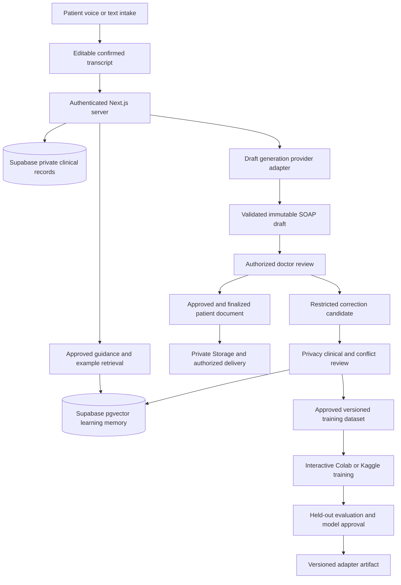

# ClinLoop AI phased implementation plan

Version 1.0 — October 9, 2026

This plan develops the existing application into a synthetic-data competition prototype, followed by a two-week final-presentation build. It includes engineering tests, actual open-weight model fine-tuning, multilingual voice intake, doctor supervision, and the redesigned website. It is a plan: no implementation, migration, training result, or clinical validation is claimed by this document.

## Agreed scope

| Decision | Implementation commitment |
| --- | --- |
| Budget | Free services only; no billing enrollment, paid trials, GPU rentals, or credit-card requirement |
| Application | Localhost Next.js application; internet still needed for Supabase and optional free inference/transcription |
| Database | Fresh Supabase PostgreSQL project, pgvector, private Storage and tested RLS; no Pinecone or separate self-hosted PostgreSQL |
| Authentication | Preserve working Better Auth initially; assess Supabase Auth compatibility before deciding whether any switch is justified |
| AI | Open-weight model for SOAP drafting and doctor-requested revisions; no ChatGPT or Claude API dependency |
| Training | Actual LoRA/QLoRA adapter training in the user's Colab or Kaggle notebook; no local training or local model-serving requirement |
| Language | English SOAP documents; English, Urdu and Roman Urdu intake; preserve the original text and confirmed translation |
| Clinical coverage | Small general-outpatient synthetic scenario set; no claim of autonomous diagnosis or prescribing |
| Voice | Initial prototype includes record, transcribe, edit and confirm; speech playback is a best-effort enhancement |
| Doctor review | Simulated workflow users during development, clearly labeled; qualified doctor review at final testing |
| Frontend | Implement supplied landing page and portal designs after delivery; backend work proceeds independently |

The prototype target from the brief is October 12. The following two weeks are planned as October 13–26, subject to the actual presentation date. These are working targets, not independently verified competition deadlines.

## Deliverables and reading order

1. This document: phases, dependencies, database and API design, acceptance gates.
2. [Free setup guide](CLINLOOP_FREE_SETUP_GUIDE.md): user-owned accounts, credentials, notebook setup and troubleshooting.
3. [Learning and evaluation specification](CLINLOOP_LEARNING_AND_EVALUATION.md): conflicting corrections, training data, model experiments and tests.
4. [Product documentation](CLINLOOP_PRODUCT_DOCUMENTATION.md): shareable product description, user journeys, capabilities and limitations.
5. [Product overview for sharing](CLINLOOP_PRODUCT_OVERVIEW.html): standalone browser-readable overview.
6. [Existing architecture audit](CLINLOOP_ARCHITECTURE_AUDIT.md): source evidence and security findings. The fresh-database decision in this plan supersedes its uncertainty about data migration.

## Architecture and boundaries

The database is shared infrastructure, but identities and raw corrections are not shared model knowledge. A document's clinical approval, a correction's permission for retrieval, and a dataset's permission for training are three separate decisions.

### Free inference and training reality

For the interactive website, reuse a free-tier provider serving an open-weight model, initially Groq if the account offers the necessary free access. This is a provider-hosted base model, not our fine-tuned adapter. Select the available model through its current catalog and save the exact ID. If unavailable, retain input and offer a pending generation state or explicit notebook batch mode; never silently switch to a paid service.

For the custom model, use finite, user-operated Colab/Kaggle notebook runs: export an authorized synthetic case package, generate with the exact saved adapter on the cloud GPU, and import the output through the authenticated local application. The server validates ownership, input hashes, schema, report version and expected job ID before creating a new draft. Imported model output never executes commands or approves documents.

This is an honest, workable no-budget demonstration: live website workflow plus actual cloud-notebook fine-tuning and inference. The first custom-model integration is batch-based, not continuously hosted. Do not promise a free always-on custom-model endpoint. Do not use a tunneled Colab web server or unattended notebook polling to bypass platform restrictions. Colab explicitly restricts unrelated web serving and free-tier bypasses of its notebook interface. See [Colab FAQ](https://research.google.com/colaboratory/faq.html).

## Phase 0 Establish a recoverable baseline

Target: October 9. Dependencies: local source; no external credentials required.

Work:

- Initialize local version control because the workspace currently has no Git repository; create a feature branch and baseline commit after checking for secrets. A GitHub account is optional for backup, not required to run locally.
- Expand `.gitignore` to cover `.env.*` except sanitized examples, notebook secrets, audio captures, generated clinical exports, model weights and private test artifacts. The current file only explicitly ignores `.env`.
- Install the lockfile dependencies, generate the Prisma client when configuration permits, and record baseline lint, type-check and build failures before changing behavior.
- Inventory every auth, clinical, report, voice and provider entry point. Preserve useful components; do not rewrite Next.js into another backend framework.
- Add a provider boundary for generation, embeddings and speech. Make missing credentials a controlled error rather than module-load failure.
- Timebox an auth compatibility assessment. Existing Better Auth remains the selected prototype path unless a tested Supabase Auth integration can preserve screens and behavior with less total risk than the required identity bridge. A change must have explicit login/session tests and a documented decision; do not run two active identity systems.

Tests I will run: dependency installation, lint, TypeScript, build, secret-pattern checks without printing values, public-page smoke test, missing-provider-config behavior.

Exit gate: recoverable source baseline, recorded existing failures, and a concrete auth decision. A failed baseline is documented and fixed where it blocks later gates; it is not hidden as a new-feature success.

## Phase 1 Secure database and identity

Target: October 9–10. Dependencies: user creates a free Supabase project and stores credentials locally using the setup guide.

Work:

- Inspect the fresh project's actual schema, extensions, grants and policies before migrations. Reuse the existing Prisma clinical and auth models in an initial baseline migration; no destructive reset or drop/recreate workflow.
- Enable pgvector through a migration and create restricted clinical, learning and evaluation objects as described below.
- Separate migration credentials, Better Auth table access, clinical runtime access and learning-review privileges. A routine web request must not use the database owner to bypass isolation.
- For retained Better Auth, derive user identity from a verified server session, set transaction-local context with bound parameters and use a non-owner, non-BYPASSRLS clinical connection. All clinical queries in that unit of work use that transaction. Auth session lookup uses its separately limited connection. Include pool-reuse and missing-context tests.
- Disable direct client access to clinical tables and restrict exposed schemas. Apply default-deny RLS and grants; privileged service keys remain backend-only.
- Treat doctor signup as an application. Only a trusted admin action can mark a clinician verified. Seed two simulated doctors, two patients, and separate reviewer/admin identities for the synthetic demo, with labels distinguishing simulation from real verification.
- Fix clinical chat identity spoofing, role promotion, broad doctor access, unauthenticated report/PDF/chat paths, voice access and the diagnostic endpoint.
- Validate request schemas and size limits, enforce same-origin/CSRF protection for cookie-authenticated mutations, rate-limit abuse-prone routes and return generic errors without sensitive payloads.
- Create private document storage with server authorization and restrictive object policies. PDFs are associated with patient, report and version, not guessed paths.

Tests I will run: patient A/B API and direct database isolation; anonymous access; doctor self-promotion; unverified/other-department doctor access; reviewer scope; runtime role RLS; default privileges; connection-pool identity leakage; private-object access; missing/expired sessions; unauthorized requests produce no model call.

Exit gate: no unauthorized read, write, object download or privileged transition in the enumerated tests. Mocked database tests alone do not satisfy this gate.

## Phase 2 Voice intake and supervised document workflow

Target: October 10–11. Dependencies: Phase 1 and optional free Groq credentials.

Work:

- Preserve voice intake using the existing Groq transcription route with authentication, type/size/duration limits, timeouts, cancellation and request limits. Support spoken English/Urdu and code switching; treat Roman Urdu as a text representation. Do not claim transcription handles all accents without tests.
- Require a visible editable transcript and patient confirmation before using it as source evidence. Keep original and English normalized text separate. Prompt for uncertain names, medication words, quantities, allergies and negations instead of silently correcting them.
- Use existing history questions plus bounded clarification prompts. Draft generation receives confirmed intake, known history and relevant approved sources. Missing vitals remain missing; self-reported symptoms do not become measured observations.
- Validate structured SOAP output with Zod. Each factual draft item carries source references; unsupported items are flagged or omitted. Assessment/plan suggestions are explicitly proposals for clinician review.
- Store immutable document versions, exact model/prompt metadata, retrieval provenance, doctor edits, section diffs, correction categories and explanations.
- Enforce transitions and revision checks in one backend service and transaction. Prevent duplicate approvals and simultaneous claims. Regeneration creates a new pending version and cannot inherit approval or a prior prescription's release authorization.
- Keep prescriptions doctor-entered/doctor-authorized; the scoped model is a drafting/revision assistant. Do not generate autonomous dosing from web examples.
- Deliver only the exact finalized version to the patient. Before finalization show status and permitted intake information, not draft medication instructions. Apply the gate to JSON, PDF, Storage and report chat alike.
- Add best-effort browser speech playback if available; retain visible text if an Urdu voice is unavailable. Do not require paid ElevenLabs or Uplift access.

Tests I will run: microphone allow/deny, empty/oversized/unsupported audio, transcription timeout/429, transcript edit preservation, Urdu/Roman Urdu negation and numbers, invalid model JSON, invented source IDs, failed generation, concurrent doctor claims, stale edits, rejection, regeneration after approval, and release checks on every delivery route.

Exit gate: a synthetic voice or text consultation reaches an immutable finalized report through an authorized doctor, with original draft and changes preserved. Voice failures retain a usable text path and do not lose the consultation.

## Phase 3 Approved learning memory and prototype demonstration

Target: October 11–12. Dependencies: Phases 1–2.

Work:

- Capture raw corrections in the private clinical area. Create generalized learning candidates separately, with privacy, clinical-quality, applicability and conflict review fields.
- Introduce explicit states: CAPTURED, PRIVACY_PENDING, CLINICAL_PENDING, CONFLICTED, APPROVED, REJECTED, REVOKED and EXPIRED. Approval is a gate over the required decisions, not simply the next arbitrary status string.
- Publish only eligible de-identified examples; use separate experimental synthetic examples for the demonstration until a qualified reviewer approves clinical reuse. Mark those records and results as simulated throughout the UI.
- Replace Pinecone retrieval with Supabase pgvector; apply approval, expiry, conflict, jurisdiction and applicability filters before ranking and recheck eligibility before generation. Start with exact search on the small corpus; add an approximate index only if measured latency warrants it.
- Record which example versions influenced each draft. Put retrieved text in a delimited data section; it cannot override system rules or authorization.
- Add correction comparison, learning review queue, visible supporting evidence and an initial evaluation screen.
- Demonstrate a conflict case explicitly: two different proposed corrections remain quarantined until reviewed; neither wins because it is newer.

Tests I will run: access to raw corrections denied to learning-only readers; unapproved/expired/revoked/conflicted examples excluded; self-publication denied; no patient IDs in published payloads; embedding errors fail safely; injected instructions ignored; revocation during generation rechecked; recorded retrieval version matches the prompt snapshot.

Exit gate: one clearly labeled synthetic correction can influence another synthetic case via approved demo retrieval, while unauthorized and conflicting examples cannot. This proves the pipeline, not clinical effectiveness or trained model weights.

## Phase 4 Fine-tuning data and cloud GPU experiment

Target: final-build days 1–5, tentatively October 13–17. Dependencies: a small stable scenario set, Kaggle/Colab access and reviewed dataset provenance.

Work:

- Create source-licensed synthetic intake-to-SOAP and draft-plus-correction-to-revised-SOAP examples. Start with a 20-example technical smoke set, then target roughly 120–300 carefully checked examples if time permits. These are planning quantities, not sufficiency claims.
- Reserve scenario families before making paraphrases/translations: approximately 70/15/15 train/validation/test, adjusted for small counts. No patient family or near-duplicate can cross splits. Keep retrieval/training examples out of held-out targets.
- Bootstrap with Synthea-derived facts and explicitly authored synthetic cases; use approved guidance as provenance where permitted. Do not scrape private prescriptions or treat drug labels as paired clinical training answers.
- Benchmark `Qwen/Qwen3-1.7B` as a small starting candidate and `Qwen/Qwen3-4B-Instruct-2507` if the assigned GPU supports a stable run. Freeze the chosen model revision after schema, multilingual and memory smoke tests. Neither model is assumed medically validated. See the model cards in the learning specification.
- Build one portable notebook using Transformers, PEFT, TRL and bitsandbytes, with versions pinned after an actual compatibility run. Use QLoRA only where the allocated GPU and libraries support it; fall back to a smaller adapter-training configuration when necessary.
- Begin with batch size 1, short bounded sequences and a small LoRA rank; choose actual settings from measured memory and validation behavior. Save checkpoints, seed, source hashes, package versions, tokenizer/chat template, adapter metadata and training metrics.
- Save the final adapter, reload it in a fresh notebook, and verify generation differs through the trained adapter path. An adapter artifact plus logs demonstrates actual parameter training; prompt edits or retrieval alone do not.
- Create authenticated synthetic job export/result import for browser review of notebook outputs. This is a finite batch exchange, not a hosted GPU API.

Tests I will run or execute through the supplied notebook: JSONL schema, provenance/license fields, identifier checks, split leakage, GPU/memory preflight, short training run, checkpoint save/resume, fresh adapter reload, base/adapter selection, malformed export rejection and stale-result import rejection. If notebook access is user-operated, I will inspect the exported logs/artifacts; I will not claim to have executed a GPU run I cannot access.

Exit gate: a reproducible adapter artifact and held-out outputs exist, with dataset limitations explicit. If no GPU allocation is available, this phase is incomplete; the app can still demonstrate retrieval but cannot claim fine-tuning has occurred.

## Phase 5 Website redesign integration

Target: begins when designs arrive; complete by final-build days 6–9, tentatively October 18–21. Backend phases do not wait for it.

Work:

- Inventory supplied HTML/React exports, screenshots, fonts, assets and usage rights. Map each design to a route and preserve the shared visual system.
- Implement landing, login/signup, patient intake/dashboard, doctor dashboard/report editor, learning review, and evaluation pages. Where a design is missing, use a restrained consistent extension and label that design decision in the handoff.
- Connect real API states: loading, empty, pending, rejected, approved, expired session, unavailable inference and failed audio. Avoid static charts or sample success metrics presented as real results.
- Keep evidence and before/after correction views accessible, with keyboard navigation, clear focus, readable contrast and mobile layouts.
- Display model identity and live/base versus notebook/fine-tuned mode. Show synthetic data and experimental evaluation labels without filling patient flows with developer settings.

Tests I will run: Playwright patient/doctor/reviewer journeys, keyboard and responsive checks, screenshot comparison to the supplied designs, network-failure paths, session expiry mid-edit, upload validation, broken-link checks, and build regression.

Exit gate: provided pages match the intended designs and all core interactions use tested backend behavior. A static landing page alone does not count as the redesign being complete.

## Phase 6 Clinical review and measurable comparison

Target: final-build days 8–12, tentatively October 20–24. Dependencies: actual model artifacts, locked held-out cases and qualified doctor availability.

Work:

- Compare the same base model under A baseline, B approved-guidance RAG, C guidance plus approved feedback RAG, D fine-tuned without retrieval, and E fine-tuned plus the same retrieval as C. This isolates retrieval from weight training.
- Present outputs in randomized, blinded order to the qualified doctor using the same rubric. Retain every failure and disagreement; report case counts and paired results rather than an invented accuracy score.
- Score unsupported facts, omitted required facts, contradictions, allergy/medication transcription omissions, source validity, correction effort and recurring errors. Record translation/voice errors separately from model errors.
- Report latency by component, notebook queue/runtime conditions and free-tier failures. Actual spend is zero only when confirmed; token counts or notional paid prices are not actual charges.
- If clinical review identifies dangerous regressions, hold the adapter as an experimental artifact and keep the previous model active. When development uses failed test cases to improve the model, designate them regression cases and reserve a new final holdout.
- Revoke unsuitable examples from retrieval immediately. For training artifacts containing them, record lineage, withdraw affected adapters and roll back; deleting a row does not remove learned weights.

Tests I will run: reproducibility checks, equal-prompt/context comparisons, metric unit tests on known fixtures, blinded-review export/import, no evaluation contamination, model rollback, and full security regression.

Exit gate: a truthful comparison report, doctor review scope, failures and limitations. Clinical review need not show an improvement to be a valid result; an unreviewed system is not promoted as clinically validated.

## Phase 7 Presentation readiness and handoff

Target: final-build days 13–14, tentatively October 25–26.

Work:

- Rehearse voice intake, SOAP evidence, correction, approval, learning review, conflict quarantine, a related-case retrieval and the notebook fine-tuning evidence.
- Prepare a clearly labeled replay of previously generated results for provider/GPU outages. Never present replay as live generation.
- Verify Supabase is active before the presentation; take recoverable schema/config and synthetic-data exports without secrets. Run a clean-machine setup rehearsal where feasible.
- Deliver setup instructions, API contract, schema/policy migrations, training notebook, dataset/model cards, test evidence, evaluation report, design handoff, and a concise presentation narrative. No unsupported privacy certification or clinical superiority claims.

Exit gate: repeatable demonstration with a tested fallback, documented unresolved issues and no unqualified claims of completion.

## Database contract

Existing `user`, `session`, `account`, `verification`, `medical_history`, `clinical_session`, `soap_report` and `doctor_profile` models remain the starting point. A fresh project allows an initial migration rather than legacy-data conversion. Cross-table patient/session consistency and assigned-doctor references must be enforced.

| Proposed record | Purpose and restrictions |
| --- | --- |
| DoctorVerification | Trusted approval, scope, approver and timestamps; never writable through profile fields |
| ClinicalDocumentVersion | Immutable SOAP and proposed plan; report/version uniqueness, original versus edited authorship, source/model/prompt versions |
| ReviewEvent | Actor, old/new status, version, reason, idempotency key and audit time |
| DoctorFeedback | Restricted before/after text and reason; same-report version references |
| LearningCandidate | Generalized content, private source mapping, privacy/clinical reviewers and eligibility decisions |
| LearningConflict | Conflicting candidates, context differences, resolution and independently approved rationale |
| LearningExample | De-identified principle, scope, sources, version, embedding, status and expiry; no patient linkage in published payload |
| GuidanceSource and GuidanceChunk | License/provenance, jurisdiction, review dates and approved retrieval content |
| RetrievalEvent | Document version, retrieved example/source versions and scores; clinical linkage remains restricted |
| DocumentObject | Private bucket/object identifier linked to exact report version and patient |
| TrainingDataset and TrainingRun | Immutable manifests, rights/approval, split hashes, run configuration, adapter artifact and lineage |
| ModelRelease | Base revision, adapter hash, evaluation gate, approval, withdrawal and rollback target |
| EvaluationRun and EvaluationScore | Locked case/config identifiers, raw outputs, rubric and reviewer records |
| AuditEvent | Content-minimized access and mutation events; append-only for routine users |

Use foreign keys, unique constraints, state checks, server transactions and expected-version comparison. Preserve revocation history. Store embeddings only for publishable content; no raw transcript vectors in shared memory. Use a fixed embedding model/dimension until an explicit re-embedding migration.

For the synthetic prototype, raw audio is transient and discarded after transcription by the application unless a specifically labeled synthetic test fixture is retained. External speech-provider retention must be checked separately; application deletion is not a claim of provider deletion. Retain synthetic versions, evaluation records and training lineage through the presentation, then perform an explicit owner-controlled archive/cleanup. Document deletion must revoke objects and pending jobs, and prevent orphaned source mappings. Test restore from a sanitized schema/data export; free managed hosting is not a substitute for a recovery plan. A real-patient retention policy is deferred to deployment governance rather than inferred from these demo defaults.

## API and authorization contract

Keep existing routes where practical; centralize their authorization in server-only helpers. Patient IDs, doctor IDs and approval roles come from the server session, never a request body's authority claims.

| Operation | Authorized actor and conditions |
| --- | --- |
| Intake/history/session | Owning patient; synthetic-only demo environment |
| Department queue | Verified doctor with allowed scope; return minimum information before assignment |
| Claim/review/revise | Verified doctor with assignment and correct current version/state |
| Finalize | Assigned verified doctor approving the exact immutable version |
| Patient document/PDF | Owner and finalized version; no draft prescription release |
| Learning candidate | Authorized clinician can submit; only designated reviewers can publish |
| Learning retrieval | Internal generation service; eligible examples only; no unrestricted browser listing |
| Training export | Authorized training operator; reviewed synthetic dataset only, never clinical tables |
| Model release | Authorized operator after evaluation; distinct from a training job finishing |
| Notebook result import | Authorized report reviewer; matching export ID, patient/report, input hash and draft revision |
| Evaluation | Authorized reviewers; only synthetic generalized results in dashboards |

Draft lifecycle: DRAFT_GENERATED → PENDING_DOCTOR_REVIEW → DOCTOR_EDITING → APPROVED → FINALIZED. Rejection is explicit. Editing/regenerating an approved/finalized version creates a new version with new review; finalized history is immutable. Backend rejection must occur before any external model/provider request whenever access is invalid.

## Testing responsibilities and evidence

I implement and run local unit, route, integration and browser tests as access permits. You create accounts, enter secrets privately, grant microphone access when required, and start notebook runs where account interaction is necessary. A qualified doctor reviews clinical correctness. Tool/runtime limitations will be reported explicitly.

Planned scripts include `test:unit`, `test:integration`, `test:security`, `test:e2e`, `eval:run` and `eval:report`; these do not exist yet. Every phase records command, commit, environment, date, passed/failed/skipped counts and artifact paths. Tests requiring Supabase or GPUs remain NOT RUN until those resources are actually used. No mock-only claim of RLS security or model training.

The test matrix and measurable model gates are specified in [Learning and evaluation](CLINLOOP_LEARNING_AND_EVALUATION.md). No unresolved critical authorization, unapproved-release or learning-publication defect is acceptable for the demo build.

## Scope control and dependency risks

If time is short, retain secure voice/text intake, versioned doctor approval, isolated learning review and honest evaluation. Reduce visual polish, optional analytics, speech playback and scenario count first. Do not remove authorization gates to meet the date. Fine-tuning and supplied designs remain final-presentation deliverables, subject to actual GPU access and design delivery.

Later scope: real-patient deployment assessments, continuous GPU hosting, institutional tenancy, external EHR integration, comprehensive medication decision support, advanced specialties and larger clinically reviewed datasets. These are not implied by a competition prototype. A minimal FHIR export is optional after core gates, not a dependency for the initial demo.
